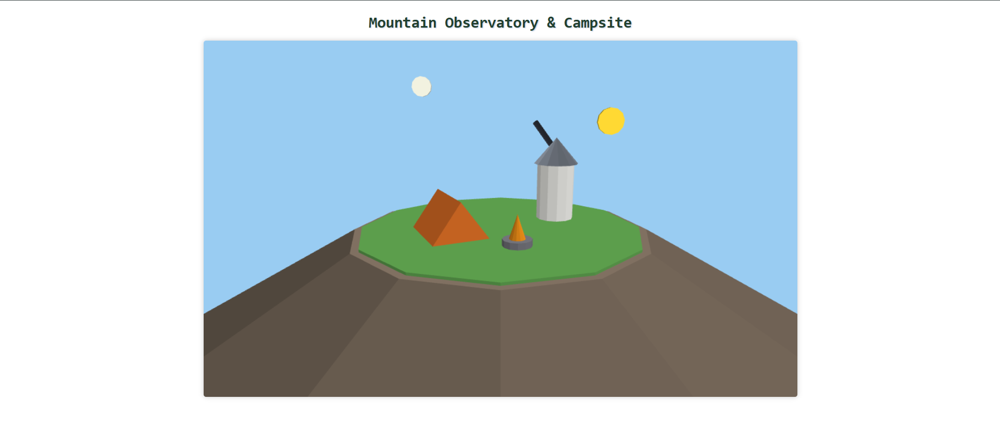
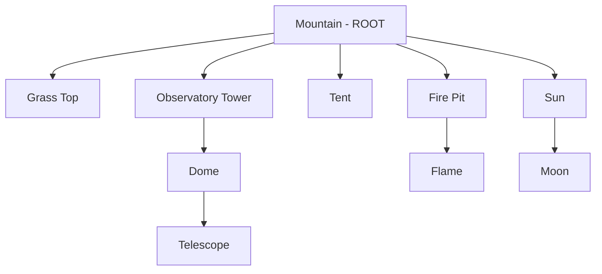

# Mountain Observatory & Campsite — Hierarchical WebGL Model

A 3D scene built with **WebGL + gl-matrix only** (no Three.js).
A flat-topped mountain carries an observatory and a campsite on its grassy top, with the Sun and Moon in the sky.

**Course:** Computer Graphics — Dr. Eman Naser Karajah

## Team

- Malak Battatt
- Mayar Battat
- Rand Hussain
- Dina Deek

## How to run

1. Open the `source code` folder in VS Code.
2. Right-click `index.html` → **Open with Live Server**.

> Don't open it by double-clicking: `fetch()` can't load the `.glsl` files from `file://`.

## Project files

```
source code/
├── index.html
├── main.js
├── shaders/   vertex.glsl, fragment.glsl
├── libs/      gl-matrix.js
├── js/        shapes.js, environment.js, observatory.js, campsite.js
└── assets/    planetarium.png
```

| File | Content |
|---|---|
| `index.html` | Canvas + script loading order |
| `main.js` | WebGL setup, camera (View + Projection), matrix stack, `drawPart()`, `drawScene()` |
| `shaders/vertex.glsl`, `shaders/fragment.glsl` | Shaders |
| `libs/gl-matrix.js` | Matrix library (v2.8.1) |
| `js/shapes.js` | The basic shapes: cylinder, cone, prism |
| `js/environment.js` | Mountain (root), Grass Top, Sun → Moon |
| `js/observatory.js` | Tower → Dome → Telescope |
| `js/campsite.js` | Tent, Fire Pit → Flame |
| `assets/planetarium.png` | Page icon |

---

# Part 1 — Hierarchical Model Structure (static)



## Hierarchy diagram

Also available as an image: [`hierarchy-diagram.png`](hierarchy-diagram.png).



```
Mountain (ROOT)               level 1
├── Grass Top                 level 2
├── Observatory Tower         level 2
│   └── Dome                  level 3
│       └── Telescope         level 4
├── Tent                      level 2
├── Fire Pit                  level 2
│   └── Flame                 level 3
└── Sun                       level 2
    └── Moon                  level 3
```

## Requirement checklist

| Requirement | Where |
|---|---|
| index.html, main.js, vertex.glsl, fragment.glsl, gl-matrix.js | `source code/` (shaders in `shaders/`, gl-matrix in `libs/`) |
| 6–10 parts | 10 parts |
| At least 3 levels | 4 levels: Mountain → Tower → Dome → Telescope |
| A parent with several children | Mountain has 5 children |
| Scale, Rotate, Translate; M = T × R × S | every part (table below) |
| Matrix stack with arrays + `mat4.clone` | `pushMatrix` / `popMatrix` in `main.js` |
| Model, View, Projection matrices | `shaders/vertex.glsl` + `setCamera()` in `main.js` |
| `gl.TRIANGLES` + a color per part | `drawPart()` in `main.js` |
| No animation | the scene is drawn once |

## Transformations of each part

Each part's final matrix is **Parent × (its own T × R) × S**.

- **T and R** form each part's own **local matrix** (`mat4.create`, `translate`, `rotate`). `mat4.multiply(modelMatrix, modelMatrix, local)` turns it into the part's world matrix, which the children inherit.
- **S** (the size) is applied inside `drawPart()` to a **copy** of the matrix, so the children don't get stretched.

| Part | Parent | Local matrix (T × R) | Scale (size) | Shape |
|---|---|---|---|---|
| Mountain | — (root) | Identity | (30, 5, 30) | cylinder with top 40% as wide |
| Grass Top | Mountain | T(0, 5, 0) | (11.4, 0.1, 11.4) | cylinder |
| Observatory Tower | Mountain | T(2.4, 5.1, -1.6) | (1.6, 2.4, 1.6) | cylinder |
| Dome | Tower | T(0, 2.4, 0) · Ry(150°) | (1.9, 1.1, 1.9) | cone |
| Telescope | Dome | T(0, 0.5, 0) · Rz(-40°) | (0.25, 1.6, 0.25) | cylinder |
| Tent | Mountain | T(-2, 5.1, 0.8) · Ry(25°) | (2.2, 1.5, 2.8) | prism |
| Fire Pit | Mountain | T(0.6, 5.1, 2.4) | (1.1, 0.25, 1.1) | cylinder |
| Flame | Fire Pit | T(0, 0.25, 0) · Ry(20°) | (0.6, 0.9, 0.6) | cone |
| Sun | Mountain | T(0, 5.1, -6) · Rz(35°) · T(7, 0, 0) | (1.4, 0.2, 1.4) disc | cylinder |
| Moon | Sun | T(-7, 0, 0) · Rz(90°) · T(7, 0, 0) | (1, 0.2, 1) disc | cylinder |

## Explanation

**Model.** The Mountain is the root and uses the identity matrix, so it sits at the center of the world. Its 5 children are positioned relative to it:

- **Children start where the parent ends.** Everything on the mountain stands at `MOUNTAIN_TOP` = 5.1: the mountain is 5 high, plus 0.1 of grass. The Dome moves up by the Tower's height (2.4). The Flame moves up by the Fire Pit's height (0.25).
- **Sun = orbit pattern** (the Solar System example from the lecture): move to the circle's center, rotate, then move out by the radius.
- **Moon = child of the Sun:** go back to the center, turn 90° more, go out again. So the Moon always stays a quarter circle behind the Sun.

**Matrix stack.** Before drawing a child we call `pushMatrix()` to save the parent's matrix. After the child we call `popMatrix()` to get it back. That way one child's transformations never affect its siblings. The stack is a JavaScript array, and `mat4.clone` copies each matrix because matrices are passed by reference.

**Camera.**
- **View matrix:** we place the camera like an object, `T(0, 10, 17) · Rx(-15°)`. The View matrix is the inverse of that (`mat4.invert`, Unit 3 – Lecture 3).
- **Projection matrix:** `mat4.perspective` with a 45° field of view.

**Shapes.** There are only 3 shape functions in `js/shapes.js`. Each shape stands on y = 0, its top is at y = 1, and it is 1 unit wide, so `scale([w, h, d])` gives the real size directly.

- **Cylinder / Cone:** a loop of 12 pieces using `Math.cos` and `Math.sin`.
- **Mountain:** the same cylinder function, but with the top circle only 40% as wide as the bottom: `buildCylinder(12, 0.4)`.
- **Prism (tent):** 2 triangles plus 3 rectangles.

Each face has a fixed brightness (`a_shade`) so the 3D form shows without lighting.

## Part 1 submission

- [x] Source code
- [x] Screenshot (`Screenshot.png`)
- [x] Hierarchy diagram (`hierarchy-diagram.png`)
- [x] Short explanation (above)

---

# Part 2 — Hierarchical Model Animation

> **Status:** not started. To be done after the Animation unit (Unit 4) is covered in class.

## Plan

| Part | Motion | Value to animate | File |
|---|---|---|---|
| Sun → Moon | Orbit across the sky; the Moon follows the Sun | `SUN_ANGLE` | `js/environment.js` |
| Dome | Rotates around Y | `DOME_ANGLE` | `js/observatory.js` |
| Telescope | Tilts up and down (child of the moving Dome) | `TELESCOPE_TILT` | `js/observatory.js` |
| Flame | (optional) grows and shrinks | flame scale | `js/campsite.js` |

The Telescope tilting on the turning Dome covers **"an animated child of an animated parent"**. The Moon also moves with the Sun, showing that children follow their parent.

## Requirement checklist

| Requirement | Where |
|---|---|
| Animate at least 2 connected parts | _TODO_ |
| One animated part is a child of another animated part | _TODO_ |
| `requestAnimationFrame()` loop | _TODO_ |
| Time-based motion (not frame-based) | _TODO_ |
| User control (Play/Pause, Speed or Reverse) | _TODO_ |

## Animated components and transformations

_TODO_

## How the parent–child relationships are kept

_TODO_

## Part 2 submission

- [ ] Final source code
- [ ] Video or GIF of the animation
- [ ] Short explanation

## Credits

* Favicon: [Planetarium icons created by Magnific - Flaticon](https://www.flaticon.com/free-icons/planetarium)
